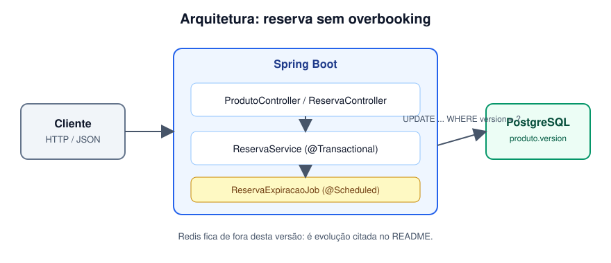
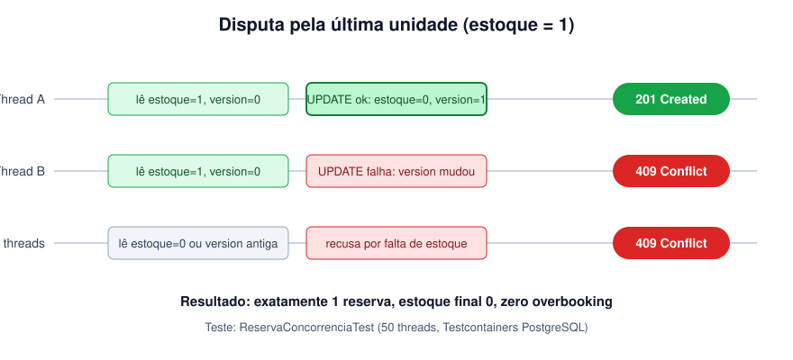

# estoque-reserva

API de reserva de estoque **sem overbooking**, em Java 21 + Spring Boot 3. Quando dois clientes disputam a última unidade, só um reserva. Reservas não confirmadas expiram sozinhas e devolvem o estoque.



## Problema

Lojas e marketplaces recebem pedidos simultâneos para o mesmo item. Sem controle de concorrência, duas requisições leem `estoque = 1`, as duas decrementam e as duas são aceitas. O resultado é vender algo que não existe: o overbooking.

Reservas também prendem estoque. Um cliente reserva e some; sem expiração, a unidade fica travada para sempre.

Este projeto resolve os dois problemas no banco de dados, com um mecanismo simples e verificável.

## Motivação

Projeto de portfólio. Concorrência e transação são uma das perguntas clássicas de entrevista para backend, e a maioria das respostas é teórica. Aqui a prova é um teste executável: 50 threads disputam uma unidade e o teste afirma que exatamente uma vence.

## Funcionalidades

- Listar produtos com estoque disponível.
- Reservar uma quantidade (reserva nasce `PENDENTE` com prazo).
- Confirmar uma reserva dentro do prazo.
- Cancelar uma reserva e devolver o estoque.
- Expiração automática de reservas vencidas, por `@Scheduled`, com devolução do estoque.
- Conflito de concorrência respondido com `409`.

## Arquitetura

```mermaid
flowchart LR
    C[Cliente] -->|HTTP JSON| API[Controllers]
    API --> S[ReservaService]
    J[ReservaExpiracaoJob] -->|@Scheduled| S
    S -->|"UPDATE ... WHERE version = ?"| DB[(PostgreSQL)]
    S -->|Flyway| DB
```

Camadas e pacotes:

| Pacote | Conteúdo |
|---|---|
| `api` | Controllers, DTOs (records) e tratamento de erros (`ProblemDetail`) |
| `reserva` | `Reserva`, `StatusReserva`, `ReservaService`, `ReservaRepository` e o job de expiração |
| `produto` | `Produto` (com `@Version`) e `ProdutoRepository` |
| `dominio` | Exceções de domínio |

Regras de negócio ficam nas entidades (`Produto.reservar`, `Reserva.confirmar`, `cancelar`, `expirar`). O serviço só orquestra transação e persistência.

### Como a concorrência funciona



`Produto` tem `@Version`. Toda alteração de estoque vira um `UPDATE` condicionado à versão lida. Quem chega depois do outro recebe `OptimisticLockException`, que a API responde com `409 Conflict`. Detalhes em [docs/05-concorrencia.md](docs/05-concorrencia.md).

### Ciclo de vida da reserva

```
PENDENTE --confirmar--> CONFIRMADA --cancelar--> CANCELADA
   |  \--cancelar--------------------------------^
   |
   \--prazo vence (scheduler)--> EXPIRADA
```

Cancelar e expirar devolvem o estoque. Confirmar não mexe nele.

## Endpoints

| Método | Caminho | Descrição |
|---|---|---|
| GET | `/produtos` | Lista produtos e estoque disponível |
| POST | `/reservas` | Cria reserva `{produtoId, quantidade}` |
| POST | `/reservas/{id}/confirmar` | Confirma dentro do prazo |
| POST | `/reservas/{id}/cancelar` | Cancela e devolve o estoque |

Exemplo completo em [docs/04-api.md](docs/04-api.md).

## Como rodar

### Com Docker Compose

```bash
cp .env.example .env        # defina POSTGRES_PASSWORD
docker compose up --build
```

API em `http://localhost:8080`, PostgreSQL em `localhost:5432`.

```bash
curl -s http://localhost:8080/produtos
curl -s -X POST http://localhost:8080/reservas -H 'Content-Type: application/json' -d '{"produtoId": 3, "quantidade": 1}'
```

### Local, com Maven

Pré-requisitos: JDK 21 e Docker (os testes de integração sobem PostgreSQL com Testcontainers).

```bash
./mvnw verify
./mvnw spring-boot:run
```

Variáveis de ambiente: veja [.env.example](.env.example). Nenhum segredo fica no repositório.

Detalhes de execução e cobertura: [docs/06-execucao.md](docs/06-execucao.md).

## Testes

| Tipo | Classe | O que prova |
|---|---|---|
| Unitário (JUnit 5, AssertJ) | `ProdutoTest`, `ReservaTest` | Regras de estoque e de ciclo de vida |
| Unitário (Mockito) | `ReservaServiceTest` | Orquestração do serviço sem banco |
| Slice web (MockMvc) | `ReservaControllerTest` | Status HTTP e validação de entrada |
| Integração (Testcontainers) | `ReservaConcorrenciaTest` | 50 threads, 1 unidade, exatamente 1 sucesso; expiração real no banco |

Cobertura de linhas medida pelo JaCoCo, com mínimo de 80% no CI.

## CI

GitHub Actions roda `./mvnw verify` a cada push e pull request: compila, executa todos os testes (incluindo o de concorrência, com Docker disponível no runner) e falha se a cobertura cair abaixo de 80%.

## Decisões

**Por que `@Version` e não lock distribuído?**
O recurso disputado é uma linha do próprio banco. Um lock distribuído (Redis, ZooKeeper) adiciona um serviço a operar e um problema novo: lock com TTL pode expirar no meio da operação e deixar duas reservas passarem. `@Version` não bloqueia ninguém: a disputa vira um conflito detectado no `UPDATE`, dentro da mesma transação, sem infraestrutura extra. Quem perde recebe `409` e pode tentar de novo. Detalhes e a alternativa pessimista (`SELECT ... FOR UPDATE`) em [docs/05-concorrencia.md](docs/05-concorrencia.md).

**Por que Flyway?**
O schema muda com a aplicação e precisa ser reproduzível. Migrations versionadas são revisáveis em PR. Hibernate roda com `ddl-auto: validate`: o JPA nunca altera o banco.

**Por que expiração por `@Scheduled` e não evento agendado no banco?**
Um job simples cobre o caso sem infraestrutura nova. O atraso máximo é TTL mais o intervalo do agendador (60 s por padrão), o que é aceitável para reserva.

**Por que `Clock` injetado?**
Torna o tempo testável sem `Thread.sleep`.

## O que faria diferente

- **Redis como evolução.** Para reduzir carga no banco em picos (ex.: lançamento de produto), um cache de disponibilidade com operações atômicas (`DECRBY` com verificação) seria o próximo passo. Não entrou agora porque introduz uma segunda fonte de verdade e exige reconciliação com o PostgreSQL. A versão atual é a fonte de verdade única.
- **Retry no cliente ou no serviço para `409`.** Hoje o conflito é devolvido ao cliente. Um retry curto no serviço melhoraria a taxa de sucesso sob contenção, à custa de latência.
- **Expiração em lotes pequenos.** O job expira num único lote transacional; um conflito de versão desfaz o lote. Transação por reserva resolveria, e fica registrado em [docs/03-servico-e-expiracao.md](docs/03-servico-e-expiracao.md).
- **Autenticação e multi-tenant.** A API está aberta. Um produto real precisaria de autenticação e de reservas ligadas a um cliente.
- **Observabilidade.** Métricas de conflito (`409`) e de reservas expiradas via Micrometer seriam úteis para ajustar o TTL.

## Documentação

| Arquivo | Conteúdo |
|---|---|
| [docs/00-escopo.md](docs/00-escopo.md) | Problema, requisitos e entregáveis |
| [docs/01-modelo-de-dados.md](docs/01-modelo-de-dados.md) | Tabelas, migrations e entidades |
| [docs/02-regras-de-reserva.md](docs/02-regras-de-reserva.md) | Regras de domínio e ciclo de vida |
| [docs/03-servico-e-expiracao.md](docs/03-servico-e-expiracao.md) | Serviço, transações e job de expiração |
| [docs/04-api.md](docs/04-api.md) | Endpoints, erros e exemplos |
| [docs/05-concorrencia.md](docs/05-concorrencia.md) | Controle otimista e teste de concorrência |
| [docs/06-execucao.md](docs/06-execucao.md) | Docker, Maven e cobertura |

## Licença

Projeto de estudo e portfólio.
